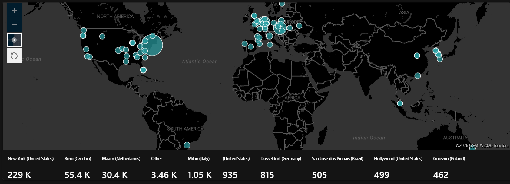
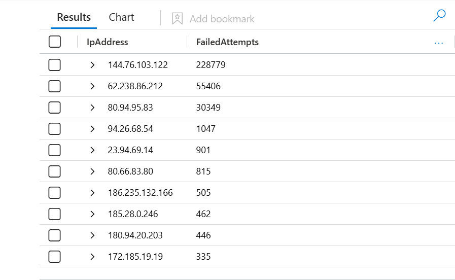
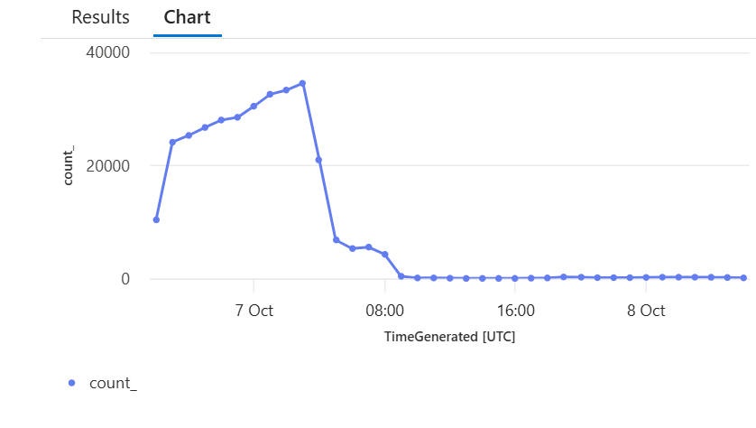
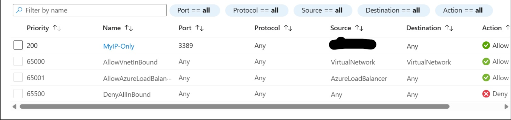

# Azure Honeypot + Microsoft Sentinel

A small cloud SOC lab: I exposed a Windows VM to the internet on purpose, collected the real attacks it attracted in Microsoft Sentinel, then hardened it and checked whether the attacks actually stopped.

Based on the lab by Josh Madakor.

## Case Note

**1. Question**
How much hostile traffic does an internet-exposed Windows VM attract, and does restricting network access actually stop it?

**2. Evidence**
- Deployed a Windows 11 VM in Azure with all inbound ports open.
- Streamed Windows Security Events to Microsoft Sentinel through the Azure Monitor Agent (Windows Security Events via AMA connector).
- Queried failed logons (Event ID 4625) with KQL.
- After about one day: about 51 distinct source IPs and 228,779 failed logons from the top source alone. Three sources produced most of the traffic. Peak rate was around 35,000 failed logons per hour.
- Enriched the IPs with a GeoIP watchlist (12,803 rows) and plotted them on a Sentinel workbook map.

**3. Conclusion**
This was automated RDP brute-forcing from many hosting-provider IPs. After I restricted RDP to my own IP, the hourly rate fell sharply. A low level of attempts (a few hundred per hour) continued, because the default RDP rule (priority 300, source Any) was still allowing outside traffic after my first change. Once I deleted that rule the last attempt was logged, and a query over the following period returned 0 failed logons while the VM was still running. Hardening has to be verified with data, not assumed.

**4. What I am not sure about**
- GeoIP shows where an IP is registered, not where the attacker is. Many of these are rented servers.
- Some IPs matched more than one location, and some fell back to a generic central-US coordinate, so the map is approximate.
- The only successful logons (4624) were NT AUTHORITY\SYSTEM, which is normal. I did not investigate beyond failed-logon telemetry.

**5. For the next analyst**
- Do not expose RDP to the internet. Use a VPN or just-in-time access.
- Keep an alert on repeated 4625 events from one source IP.
- Re-check NSG rules after every change.

## Repository contents

- `reports/Incident_Report_RDP_Brute_Force.md`: full incident report (timeline, analysis, threat intelligence, recommendations)
- `reports/Malware_Triage_Note_EvilTokens.md`: triage note based on a public ANY.RUN sandbox report
- `queries/kql-queries.md`: the KQL queries used in the lab
- `screenshots/`: attack map, top source IPs, attempts per hour, NSG rules

## Screenshots

**Failed RDP attempts by source location**

**Top source IPs by failed attempts**

**Failed attempts per hour (peak, then drop after hardening)**

**NSG inbound rules after hardening**

## Tools

Microsoft Azure, Microsoft Sentinel, Log Analytics, Azure Monitor Agent, KQL, Windows Security Events, Sentinel Watchlists and Workbooks.
